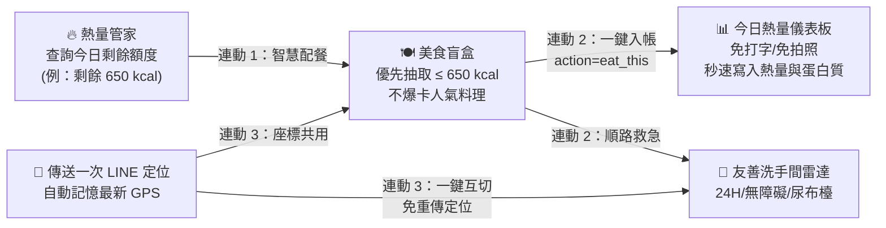

# 🧭 美食抽籤 × 熱量控制 × 附近洗手間『外出生活三合一超級選單』LINE 官方帳號
**(Outdoor Life 3-in-1 Super Hub LINE Bot)**

> 深度整合 **「🍽️ 不要什麼都隨便（美食盲盒與周邊餐廳）」**、**「🔥 熱量控制小幫手（AI 營養管家）」** 與 **「🚻 廁所在哪裡（救急友善洗手間雷達）」** 三大高頻外出生活剛需，打造具備 **LINE Rich Menu Alias 多頁籤秒速切換** 與 **三大跨模組全流程閉環連動** 的全能型 LINE 官方帳號！

---

## 🌟 核心亮點與三大跨模組閉環連動

### 📱 1. LINE 多頁籤圖文選單切換系統 ([`setup_rich_menu.py`](./setup_rich_menu.py))
完整實作 LINE Messaging API 的 **Rich Menu Alias (`richmenuswitch` action)** 多頁籤架構，頂部配置 3 顆頁籤切換熱區（2500×286），下方配置 6 宮格功能熱區（2500×1400）：
- **Tab 1 (`richmenu-alias-food`)**：**🍽️ 美食盲盒與周邊餐廳**（暖橘主題 [`static/richmenu_food.png`](./static/richmenu_food.png)）
- **Tab 2 (`richmenu-alias-calorie`)**：**🔥 AI 熱量管家與營養追蹤**（翠綠主題 [`static/richmenu_calorie.png`](./static/richmenu_calorie.png)）
- **Tab 3 (`richmenu-alias-toilet`)**：**🚻 救急友善洗手間雷達**（靛藍主題 [`static/richmenu_toilet.png`](./static/richmenu_toilet.png)）
- 內建 Pillow 自動繪圖引擎，執行 `python setup_rich_menu.py` 即可自動生成 3 張 2500×1686 高解析度圖文選單並一鍵部署至 LINE 伺服器。

---

### 🔗 2. 獨家跨模組全流程閉環連動 ([`hub_router.py`](./hub_router.py))



1. **【連動 1：從「熱量剩餘額度」智慧抽美食】**：
   - 當使用者輸入「吃什麼」、「隨便」或點擊選單「🥗 依剩餘熱量抽美食」時，系統自動查詢使用者在「熱量管家」中今日還剩多少卡路里額度（例如今日目標 `2000 kcal`，已攝取 `1350 kcal`，剩餘 `650 kcal`），優先推薦熱量在剩餘額度內的不爆卡美食！
2. **【連動 2：抽中美食後「一鍵記熱量」與「找順路洗手間」】**：
   - 每張抽出的美食推薦 Flex Message 卡片（含預估熱量、蛋白質/碳水/脂肪、價格區間與 Google Maps 導航）底部直接配置三顆跨模組連動按鈕：
     - `🔥 就決定吃這個！一鍵記入今日熱量`（Postback `action=eat_this&food_name=...&calories=...&protein=...`）：點擊後免打字、免拍照，直接將該餐點寫入今日飲食紀錄，並彈出更新後的今日熱量儀表板卡片！
     - `🎲 換一個（再抽一次）`
     - `🚻 找附近的友善洗手間`
3. **【連動 3：GPS 定位一次傳送，雙模組智慧共用】**：
   - 當使用者傳送 LINE 位置訊息（Location Message）時，系統除了根據當前模式（找廁所或找美食）立即回傳周邊據點（如速食店、加油站、超商、咖啡廳、公園公廁、圖書館、百貨洗手間，含 `🕒 24H` / `♿ 無障礙` / `🍼 尿布檯` 標籤與步行時間），卡片底部還提供 **「🔄 用同一個定位改找附近美食 / 附近洗手間」**（自動記憶使用者最新 GPS 座標於資料庫中，完全不需重複傳送定位！）。

---

## 📂 專案架構

```text
line-outdoor-life-hub/
├── main.py               # FastAPI 伺服器、LINE Webhook (/callback) 與 Web 模擬 API 端點
├── hub_router.py         # 三合一跨模組意圖路由器與 Postback / Location 閉環控制器
├── food_module.py        # 美食盲盒資料庫、依剩餘熱量篩選邏輯與 Google Places 周邊餐廳搜尋
├── calorie_module.py     # BMR/TDEE 計算、Gemini Vision 拍照辨識與自然語言飲食熱量估算
├── toilet_module.py      # 救急友善洗手間雷達 (24H/無障礙/尿布檯標籤與步行時間計算)
├── flex_builder.py       # 三合一高質感 LINE Flex Message 卡片與 Carousel 輪播產生器
├── database.py           # SQLite / Supabase PostgreSQL 雙支援資料庫 (含 GPS 記憶與飲食記帳)
├── setup_rich_menu.py    # Pillow 三頁籤圖文選單自動繪製與 LINE Rich Menu Alias 部署腳本
├── test_outdoor_hub.py   # 完整單元與整合測試套件 (7 大核心測試 100% 通過)
├── static/               # 自動繪製之 3 張 2500x1686 多頁籤 Rich Menu 圖檔
│   ├── richmenu_food.png
│   ├── richmenu_calorie.png
│   └── richmenu_toilet.png
├── templates/
│   └── index.html        # 三合一跨模組 Web 互動預覽與模擬測試儀表板
├── requirements.txt      # Python 套件相依清單
├── Dockerfile            # 容器化部署設定
├── render.yaml           # Render 雲端一鍵部署設定
└── vercel.json           # Vercel Serverless 部署設定
```

---

## 🚀 快速啟動與測試

### 1. 安裝相依套件
```bash
pip install -r requirements.txt
```

### 2. 自動繪製並部署三頁籤 Rich Menu
```bash
python setup_rich_menu.py
```

### 3. 執行自動化測試套件
```bash
python test_outdoor_hub.py
```

### 4. 啟動本地伺服器與互動模擬台
```bash
uvicorn main:app --reload --port 8000
```
- 瀏覽器開啟 `http://localhost:8000` 即可使用 **三合一跨模組即時模擬測試台** 與預覽 3 張多頁籤圖文選單！
- LINE Webhook URL 請設定為：`https://<您的網域>/callback`
